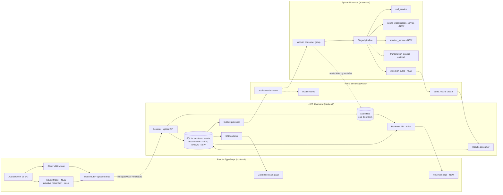
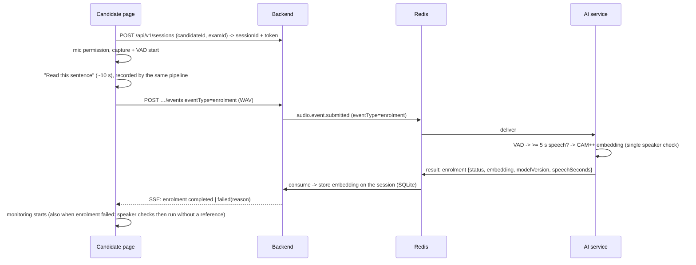

# Standalone architecture design

Status: design (24 Nov 2026). **Scope change:** this application is a complete, independent audio-proctoring
system. It does **not** integrate with, call, or depend on any other proctoring system (its React app, .NET backend,
Redis, AI application, WebSocket protocol, database or authentication). An earlier version of this file described
such an integration; that design is withdrawn. The model research and detection strategy remain valid.

Related: [model-comparison.md](model-comparison.md) · [detection-strategy.md](detection-strategy.md) ·
[evaluation-plan.md](evaluation-plan.md) · current system: [../architecture.md](../architecture.md) · phases:
[../implementation-plan.md](../implementation-plan.md)

## 1. What already exists (verified from source, 24 Nov 2026)

| Service | Implemented and tested | Not yet implemented |
|---|---|---|
| **Frontend** (`frontend/`, React 19 + TS + Vite) | Candidate exam page; mic + camera permissions; AudioWorklet 16 kHz capture; browser Silero VAD in a worker; event state machine (pre-roll 2.5 s, 1.5 s silence end, pause merge, min speech, max 10 s, split with 1 s overlap, 0.5 s tail); WAV encode + validate; IndexedDB; idempotent upload queue with retry; SSE live status; diagnostics; local video clips | Non-speech **sound trigger**; **voice enrolment** step; **reviewer interface**; observation display |
| **Backend** (`backend/`, .NET 9, EF Core SQLite) | Sessions (`POST /api/v1/sessions`, `GET …/{id}`, `POST …/{id}/end`) with per-session bearer token; upload `POST …/{id}/events` (multipart, WAV + metadata validation, idempotency); event list/get/result; audio on local disk; Redis Streams outbox publisher; results consumer; SSE `GET …/{id}/updates`; retention; health | `eventType` other than `speech` (schema: `const: "speech"`, trigger `const: "vad"`); enrolment / speaker reference; **observations table** (results are stored as one JSON blob `result_json`); **reviewer API** (session list, timeline, audio download, review decisions) and reviewer authentication |
| **Redis Streams** (`infra/docker-compose.yml`) | `proctoring.audio.events.v1` / `proctoring.audio.results.v1`, consumer groups, XAUTOCLAIM retries, DLQs, idempotent receivers; **no audio bytes in Redis** (`audioRef` to the shared store) | – (contract v2 only) |
| **AI service** (`ai-service/`, Python 3.12, FastAPI) | Redis worker; WAV validation; Silero VAD; optional faster-whisper (off by default); rule findings (`info`); health | `speaker_service`, `sound_classification_service`, `detection_rules`, observations v2 |
| **Contracts** (`docs/contracts/`) | JSON Schemas v1 + examples + validator | v2: event types, trigger types, observations |
| **Tests** | frontend 36, backend 260, AI 76 (+ real-model tests), browser E2E 22 checks | labelled evaluation set + scoring |

The architecture already matches the requested standalone design (React → .NET → Redis Streams → Python → .NET →
SSE → React). The work is to **extend** each service, not to restructure it.

## 2. Target architecture

All components run on one developer machine: Redis (and optionally the AI service) via Docker Compose, backend and
frontend via PowerShell (`dotnet run`, `npm run dev`). No cloud service is used for inference or storage.

## 3. Data flows

### 3.1 Exam start with voice enrolment (new)

The backend includes the session's reference embedding (192 floats, ~2 KB JSON [A: CAM++ output size to verify])
in every later `audio.event.submitted` message, so the AI service stays stateless and any worker can process any
event. The embedding is biometric data: it is deleted with the session's other data by the retention job.

### 3.2 Speech or sound event

1. Browser trigger fires (`vad` for speech, `sound` for a non-speech onset; rate-limited).
2. Clip cut from the rolling buffer, encoded as 16 kHz mono PCM16 WAV, validated, stored in IndexedDB.
3. `POST /api/v1/sessions/{id}/events` with `eventType` = `speech` | `sound`, `trigger.type` = `vad` | `sound`.
4. Backend validates, stores the WAV on disk, inserts the event, outbox → `audio.event.submitted` (with `audioRef`
   and, if present, the speaker reference).
5. AI worker runs the staged pipeline ([detection-strategy.md §2](detection-strategy.md#2-pipeline-overview)) and
   publishes `audio.analysis.completed` v2 with `observations[]`.
6. Backend stores the result **and** one row per observation; SSE notifies the candidate page (status only) and the
   reviewer page (observations).

### 3.3 Review

Reviewer opens the reviewer page → enters the reviewer key → picks a session → sees the timeline of all audio
events (speech and sound), each with processing status, observations (type, confidence, time, duration,
evidence, model) and an audio player streaming the original clip from the backend. The reviewer marks each
observation `dismissed` or `relevant` with an optional note. Nothing is labelled as cheating.

## 4. Contract changes (v2, backwards-compatible where possible)

| Contract | Change |
|---|---|
| `audio-event-metadata` | `eventType`: `speech` \| `sound` \| `enrolment`; `trigger.type`: `vad` \| `sound` \| `enrolment`; sound trigger fields (`onsetDb`, `noiseFloorDbfs`) |
| `audio-event-message` | optional `speakerReference { embedding[], model, modelVersion }` |
| `analysis-result` | v2: `observations[]` ([detection-strategy.md §5](detection-strategy.md#5-observation-types)), `sound { tags per frame (top-k) }`, `speaker { segments, similarities }`, `enrolment { status, embedding }` for enrolment events; v1 `findings` kept during transition |
| HTTP | new: `GET /api/v1/review/sessions`, `GET /api/v1/review/sessions/{id}/timeline`, `GET /api/v1/review/events/{eventId}/audio`, `PUT /api/v1/review/observations/{id}` (decision + note); all need the reviewer key |

**Reviewer authentication (prototype):** a reviewer key configured in `backend/.env` (`REVIEWER_API_KEY`, stored
hashed in memory), typed by the reviewer into the reviewer page and sent as a bearer token. It is never put in a
frontend `VITE_*` variable or the bundle. Candidate session tokens cannot access reviewer routes, and the reviewer
key cannot upload events.

## 5. Storage

| Data | Where | Retention |
|---|---|---|
| Sessions (+ enrolment status, reference embedding) | SQLite | session retention (new setting, default 7 days) |
| Audio events (metadata, status, result JSON) | SQLite | as sessions |
| **Observations** (one row each) + **review decisions** | SQLite (new tables) | as sessions |
| Audio WAV files | local filesystem (`AUDIO_STORE_PATH`), never in SQLite | `AUDIO_RETENTION_HOURS` (today 24 h; the reviewer flow needs longer → default to 7 days for the demo) |
| Browser copies | IndexedDB | `VITE_LOCAL_RETENTION_DAYS` |

## 6. Transport decision

Keep the implemented design: **event clips as WAV on the local filesystem, Redis carries only a reference**
(`audioRef` with SHA-256 and size). It is already tested (outbox, retries, DLQ, idempotency); Redis messages stay
~1–3 KB; the AI service reads the shared directory (bind mount in Docker, same path when run natively). Continuous
streaming was rejected (≈ 115 MB/h of PCM, continuous recording, VAD on all audio); bytes-in-Redis is unnecessary
because both services share the disk on one machine.

## 7. Resources on the development machine

Machine: i5-13450HX (10 cores), 15.7 GB RAM with typically ~2 GB free, RTX 3050 6 GB (GPU optional).
Measured ([model-comparison.md](model-comparison.md#measured-on-this-machine)): Silero VAD 158 ms per 10 s clip,
process peak 220 MB; faster-whisper base 1.3 s / 332 MB. New models (EfficientAT mn10_as ~4.9 M params, CAM++
~7.2 M, pyannote segmentation ONNX 5.7 MB) are small, but **not yet measured** [E: total AI process < 1 GB without
Whisper]. Rules: each model loaded once at start-up; ONNX/PyTorch thread counts capped (`OPENBLAS_NUM_THREADS=4`
already set); Whisper stays off by default; every phase measures peak memory before moving on.

## 8. Timestamps

One clock: the browser's audio clock mapped to wall time (implemented, with the Phase 6 validity fix). Clips carry
`startedAt`/`endedAt`; observations carry absolute `startTimestamp`/`endTimestamp` = `startedAt` + offsets; the
backend rejects clips outside the session ± skew. The reviewer timeline orders events and observations by these
timestamps.
